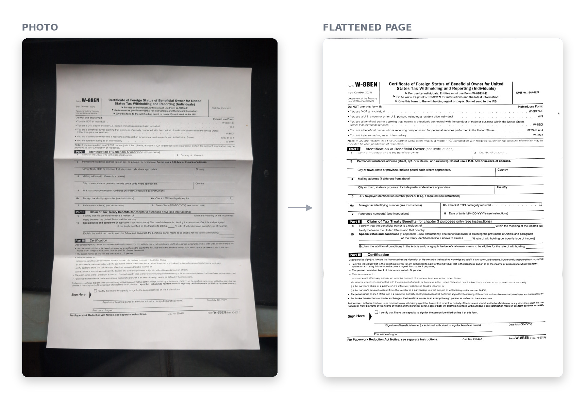

# docscan3d

One photo of a folded or curved page → flat, scanner-like image.



- **Android app** — [android/README.md](android/README.md): one photo on the phone, live page
  outline, flash, pinch-zoom, 200 dpi A4 PNG.
- **C++ command line** — [cpp/README.md](cpp/README.md): the same one-photo pipeline on a computer,
  `flat.png` only.
- **Python reference** — this file: 2–4 views with a measured 3D surface; used to develop and
  benchmark the algorithm.

One photo is enough for OCR; the multi-view pipeline measures the folds in 3D instead of correcting
them from the outline and printed lines, so its geometry is about 2× more exact.

## One photo (app / C++)

```
cpp/build/docscan page.jpg -o out --focal-px 3030   # focal in px at full resolution
```

1. Page outline, corners refined to subpixel on the paper edge.
2. Page plane from the four corners; the focal length comes from EXIF (CLI) or the camera
   characteristics (app), so no calibration is needed.
3. The measured outline is pulled onto the A4 rectangle; printed lines and text lines are
   straightened, with the measured content holding the correction in place.
4. Shading removed, paper cleaned; the result is turned so the text is upright.

There is no 3D measurement inside the page. OCR reads one photo as well as 2 or 4 views (tesseract,
5 samples: 92–98 % of the scan's words); geometry is about 2× less exact (median 0.18–0.48 mm vs
0.14–0.25 mm against the scans). Text lines are tracked per 3 mm column (median row of dark ink,
underlines removed) and linked over word gaps, so lines that kink at a crease stay whole; with one
photo they weigh 8× more. On 4 one-photo samples text tilt went from 0.2–0.6° rms to 0.07–0.3°, and
tesseract finds 96.6 % of the PDF's words (OCR of the PDF image itself: 97.2 %).

`--doc-tone` / the app's "Clean look" (on in the app): black ink on white paper. The black point
follows the darkest ink within ~3 mm, so thin print that the camera blurs to grey is darkened
rather than faded. OCR is about the same with and without it (details in cpp/README.md).

## Python reference (2–4 views)

```
pip install opencv-python numpy scipy pillow matplotlib
python3 docscan3d.py ref.jpg right.jpg up.jpg down.jpg -o out   # 4 views: focal self-calibrated
python3 docscan3d.py ref.jpg right.jpg -o out --focal-px 3030   # 2 views: focal is kept fixed, pass it
```

The first image is the reference that gets rendered. With 4 views the focal length is self-calibrated
(no checkerboard needed); with 2 views it is not observable, so pass it (Pixel 8, 16:9 mode: ~3030 px).
The one-photo path is implemented in the C++ port and the app; the Python code is the multi-view
reference.

### Capture

- Same phone, same lens, same zoom, focus locked if possible.
- View 1 shows the whole page; it is the one that gets rendered.
- View 2: move the phone 10–20 cm sideways at the same height (aim for a reported triangulation angle > 8°).
- Page brighter than the background (dark table).
- If the phone doesn't write `FocalLengthIn35mmFilm` to EXIF, it assumes 26 mm equiv; the focal is refined in bundle adjustment anyway.

### Pipeline

1. Page outline in view 1, corners refined to subpixel on the paper edge.
2. SIFT + mutual ratio test, essential matrix (MAGSAC), pose.
3. NCC refinement of matches on affine pre-warped patches.
4. Bundle adjustment (pose, points, focal), robust triangulation.
5. Guided densification: corners in view 1, predicted in view 2 from nearby matches, NCC refined; outliers rejected against the sparse surface.
6. Page frame: best-fit plane, axes along the page edges. Scale from the known page size.
7. Robust height field z(u, v) (IRLS, second-difference regularizer).
8. Isometric unrolling of the height-field mesh (edge lengths preserved), corners re-intersected with the surface, scale re-measured on the unrolled outline, then repeated once.
9. Render: flat pixel (s, t) → (u, v) → (u, v, z) → pixel in view 1.

## Outputs (`out/`, Python)

| file | content |
|---|---|
| `points.csv` | `u_mm, v_mm, z_mm, s_mm, t_mm, x1, y1, x2, y2, reproj_px` per measured point |
| `points.ply` | same points in page frame, colored |
| `heightfield.npz` | grid `u`, `v`, `z`, unrolled grid `st`, camera `K`, `R`, `t`, page frame |
| `heightfield.png` | fitted height map + measured points |
| `flat.png` | flattened page at `--dpi` (default 200), shading removed, paper cleaned (grey PNG if no colour) |
| `flat_raw.png` | same, original illumination |
| `overlay.jpg` | view 1 with detected page and points colored by height |
| `report.json` | point count, reprojection error, baseline, distance, strain, ... |

The C++ CLI writes only `flat.png`; the app writes the final PNG (A4, 200 dpi) to its result screen.

## Output

`flat.png` is the flattened page with the illumination divided out: the paper is modelled as
a smooth function of position and of the measured surface normal (fold shading), fitted to
the paper level (ink is darker and gets down-weighted), so printed grey areas stay grey.
`flat_raw.png` is the same geometry with the original lighting. `--fuse` blends all views
(meant for glare or a phone shadow in single shots); on the test samples it gave no image
gain and slightly worse geometry, so it is off by default.

Paper non-uniformity vs. the raw render (`test/eval_photo.py`, on scan-defined paper areas):
sample 1 10.6 % → 3.0 %, 2 8.2 % → 5.5 % (rest is show-through from the printed back side),
4 6.4 % → 2.3 %, 5 7.0 % → 1.4 %; edge sharpness unchanged.

Paper cleanup (default, `--no-clean` to skip): denoise (non-local means), even out small
paper-level variations (texture, faint show-through) while larger deviations such as printed
grey fills stay, then a ramp pushes the paper to white. Pages without real colour are written
as single-channel PNG. On the 5 samples: 4.6 MB → ~0.6 MB per page, edge sharpness vs. scan
0.889 → 0.907, local NCC to scan 0.570 → 0.600. Geometry is not touched; note that
`eval_real.py` (CLAHE + SIFT) reacts to image tone, so its numbers move by up to ~0.02 mm
median / ~0.15 mm p95 per sample on identical geometry. Compare geometry with `--no-clean`.

## Speed and memory

One photo, C++ CLI: about 1–3 s per page on a 16-core desktop (GPU SIFT); the Android app adds the
phone-side work. Python, 2–4 views: per-view matching and densification run in threads (`--threads`,
default: all cores; OpenCV and large numpy ops release the GIL). SIFT is detected in overlapping
tiles (OpenCV upsamples the image 2× internally, ~2 GB on a full photo otherwise), rendering works
in row strips, and only the views that are still needed are kept in memory. `--minimal` skips the
debug outputs (`points.ply`, `heightfield.png`, `overlay.jpg`, `flat_raw.png`).

The bundle adjustment uses an exact Jacobian (points are re-triangulated inside, so this
includes the derivative of the triangulation), the unrolling a Gauss-Newton solve with a direct
sparse factorization. Random steps (FLANN, MAGSAC) are seeded per view, so results do not depend
on the thread count; the essential matrix is estimated up to 4 times and the model with the most
inliers in front of both cameras is kept (a single MAGSAC run occasionally returned a wrong pose).

On the 5 samples (4 views, 16 threads): 124 s → 75 s total (~13–17 s per page), peak memory
2.35 GB → ~1.1 GB. 2 views: 57 s → 48 s.

## Real-photo results (Pixel 8, 5 folded letters, vs. flatbed scan)

`test/batch_real.sh` runs all samples and compares the output with the scans (`test/eval_real.py`).

One photo (C++/app): OCR reads 92–98 % of the scan's words (same as 2/4 views); geometry median
0.18–0.48 mm, about 2× less exact than 4 views. The table below is the Python multi-view reference.

| | median | p95 | worst panel | coverage |
|---|---|---|---|---|
| 4-corner homography (what apps do) | 1.00 mm | 3.04 mm | 2.03 mm | 0.74 |
| 2 views, known focal | 0.34 mm | 0.96 mm | 1.10 mm (one panel lost) | 0.72 |
| 4 views, self-calibrated (default) | 0.27 mm | 0.63 mm | 0.47 mm | 0.79 |

Extreme fold (2 views, ~45° creases, downscaled chat photos): 0.34 mm median, p95 0.59 mm.

### Steep folds

- Tilt-simulated (ASIFT-style) matching kicks in automatically when plain SIFT matches
  leave the page uncovered (`--asift auto|on|off`); steep panels look too different between
  views otherwise.
- Fold prior: if the surface bends in one direction only (parallel letter folds), the frame
  is turned along the folds and the paper is kept straight along them (`--ruling`, 1 = off).
  This also helps normal letters; curls and diagonal folds keep the isotropic model.
- Map corrections after flattening, as smooth displacement fields on the flat page:
  1. edges: the page outline seen in the photo is exact, so it is put on the rectangle; measured
     content holds firmly, so the correction stays in the margins (`--no-edge-fix`);
  2. lines: printed near-horizontal/vertical lines (LSD in a provisional render) must be straight
     and axis-parallel; measured content holds only weakly (`--anchor-w`), the outline stays put
     (`--no-line-fix`). This fixes regions the 3D measurement could not cover, e.g. tables whose
     identical rows defeat feature matching.
- Where the page outline was triangulated, its measured 3D position is used directly; otherwise
  the ray is intersected with the surface, taking the crossing nearest the expected depth.
- Photos with almost no viewpoint change (or the same image twice) stop with a clear message.
- The height-field extent follows the data (steeply folded pages do not sit at 0..W x 0..H).

## Scan-free line metric

`test/eval_lines.py flat.png [--hist h.png --vis v.jpg]` scores how much printed line length is
within 0.25 deg of horizontal/vertical (after removing the global rotation), RMS angle, and bend
of long rules. Reference: the flatbed scans score 69-98 %.

Note on the scans: they are sheared by 0.4-0.6 deg (vertical vs. horizontal lines) and have their
own x/y scale error, so `eval_real.py` now registers with a full affine transform (`--similarity`
for the old behaviour). Global geometry is checked by the A4 outline and the line metric instead.

## Synthetic test

```
python3 test/make_synthetic.py -o test/synth            # folded A4 letter, 2 views, known geometry
python3 docscan3d.py test/synth/view1.jpg test/synth/view2.jpg -o test/out
python3 test/evaluate.py test/synth test/out
```

Results (3000×4000 px, ~380 mm distance, folds 9° / −7°, curl + bent corner, noise, blur, JPEG):

| | 150 mm baseline | 60 mm baseline | 4-corner homography (what apps do) |
|---|---|---|---|
| 3D surface error (rms) | 0.042 mm | 0.040 mm | – |
| local warp in flat output (median / p95) | 0.066 / 0.17 mm | 0.069 / 0.19 mm | 0.37 / 1.08 mm |
| global scale error | 0.03 % | 0.05 % | 0.6 % |

## Limitations / next steps

- No lens distortion and no rolling shutter in the model. For real phones calibrate once with a
  checkerboard and pass `--calib`: `np.savez("calib.npz", K=K, dist=dist, size=(w, h))` with
  `K, dist` from `cv2.calibrateCamera`. Fitting distortion from the photos themselves made the
  results worse, so it is opt-in.
- One photo cannot measure the surface inside the page; folds are corrected from the outline and
  printed/text lines. This is fine on normal letters, weaker on a strongly curled sheet.
- Blank areas have no matches; the height field interpolates there. Page corners usually lie in such areas, which is where the remaining ~0.5 mm global offset comes from.
- Height field regularization rounds sharp creases a bit; a finer `--grid` with a lower `--smooth` keeps them sharper if the point density allows.
- Page detection needs a page brighter than its background; no segmentation network yet.
